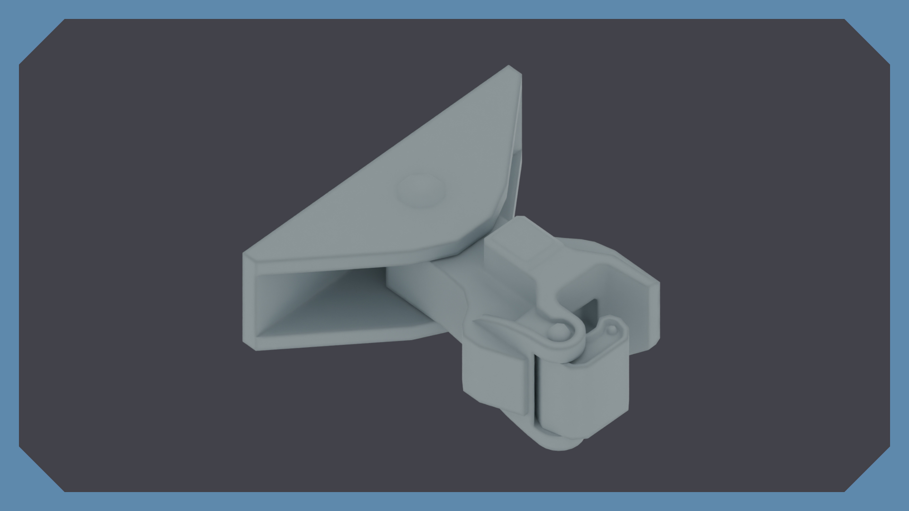

# Train-Coupler mod for Scrap Mechanic

Make use of Smart Physics by linking your creations without combining them into
one creation.

  

## About

The **Train-Coupler** mod lets you physically couple separate creations, such as
locomotives, railcars, and trailers, while keeping them as independent physics
bodies. Coupled creations retain the performance advantages of *Scrap
Mechanic*'s Smart Physics for separate creations. This allows you to build long
trains without large performance compromises.

### Highlights
* **Independent Physics Bodies:** Link multiple creations together without
  combining them into one creation.
* **Physics Performance:** Taking advantage of *Scrap Mechanic*'s Smart Physics,
  Train Couplers retain the performance advantages of separate creations.

## Contributing

Contributions, bug reports, and ideas are welcome! Before starting work on new
features, parts, or balance changes, please read our **[Contribution
Guidelines](CONTRIBUTING.md)** and **open an Issue first** so we can discuss how
the change fits the mod's vision and balance.

Any contribution should align with the project's vision as outlined in
[CONTRIBUTING.md](CONTRIBUTING.md#project-vision--design-philosophy). Any
changes should fit the vanilla game and result in a balanced gameplay
experience.

## License & Terms

This project (including all Lua scripts, JSON definitions, 3D models, textures,
and audio assets) is licensed under the **GNU General Public License v3.0
(GPLv3)** with **Additional Permissions (Section 7)** for *Scrap Mechanic* and
the Steam Workshop:

* **Full License Text:** See [`LICENSE`](LICENSE) for the complete GNU GPLv3
  terms. You are free to use, modify, and redistribute this mod and its assets,
  provided any derivative work is also released under the GPLv3 with its
  corresponding source code and editable 3D files.
* **Steam Workshop & Game Exceptions:** See
  [`LICENSE-EXCEPTION`](LICENSE-EXCEPTION) for the additional permissions
  allowing Valve Corporation (Steam Workshop) and Axolot Games AB (*Scrap
  Mechanic*) to host, distribute, and integrate this mod under their respective
  platform terms.
* **Contributor Terms:** By submitting a Pull Request or asset to this
  repository, you agree to license your contribution under both
  [`LICENSE`](LICENSE) and [`LICENSE-EXCEPTION`](LICENSE-EXCEPTION) as outlined
  in [`CONTRIBUTING.md`](CONTRIBUTING.md).